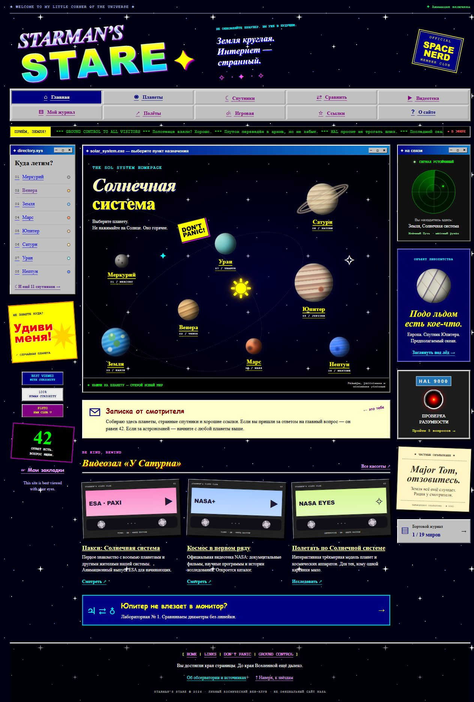

# Starman’s Stare

Личный космический веб-клуб в духе 1998 года. Звёздные обои, планеты-ссылки, VHS-кассеты, системные шрифты и немного научной фантастики.

**Статус: рабочая черновая версия.**

[Открыть сайт](https://shalombaby666.github.io/starmans-stare/)

## Что работает

- Атлас восьми планет и досье 11 выбранных спутников.
- Сравнение планет: экваториальный диаметр, гравитация, период вращения, орбитальный период и среднее расстояние от Солнца. Круги в сравнении сохраняют пропорции диаметров.
- Видеотека с фильтрами и внешними ресурсами NASA и ESA.
- Архив трёх событий миссий Voyager и Cassini–Huygens.
- Викторина из пяти вопросов с объяснениями и ссылками на источники.
- Локальный бортовой журнал и закладки; данные сохраняются в браузере.
- Переключатель анимации, поддержка `prefers-reduced-motion`, клавиатурная навигация и мобильная раскладка.



[Мобильная версия — скриншот](docs/screenshots/mobile.png)

## Запуск

Нужны Node.js 22.18+ и npm.

```sh
npm ci
npm run dev
```

Vite выведет локальный адрес. Для сборки и проверки:

```sh
npm test
npm run build
npm run preview
```

Сборка находится в `dist/`. Сервер и ключи API не нужны. Относительные пути позволяют размещать сайт в подпапке GitHub Pages. Прямое открытие `index.html` через `file://` не поддерживается — используйте HTTP-сервер.

## Технологии и устройство

React 19, TypeScript, Vite. Маршруты используют hash-навигацию и работают на статическом хостинге без серверных перенаправлений.

- `src/data.ts` — типизированный каталог объектов и материалов.
- `src/domain.ts` — проверка сохранённых отметок, форматирование и расчёт отношений диаметров.
- `src/App.tsx` — оболочка клуба, атлас, досье, сравнение, видеотека и журнал.
- `src/ClubRooms.tsx` — викторина, миссии и закладки.
- `src/styles.css` — базовая геометрия и рисунки планет.
- `src/retro.css` — согласованная версия оформления с системными шрифтами 90-х.
- `tests/domain.test.ts` — проверка данных, сравнений и повреждённого локального хранилища.

Шрифты: Times New Roman, Arial Black / Impact, Courier New, Comic Sans MS и Arial, с системными альтернативами. Внешние шрифты и аналитика не загружаются.

## Источники и ограничения

Физические параметры планет — [NASA Planetary Fact Sheet](https://nssdc.gsfc.nasa.gov/planetary/factsheet/), редакция от 18 марта 2025 года. В интерфейсе приведены округлённые значения. Гравитация у гигантов относится к уровню давления 1 бар; значения таблицы учитывают вращение. Период вращения указан относительно звёзд, а не между восходами Солнца. Для Венеры и Урана отмечено обратное вращение.

Описания и ссылки на подробности — [NASA Science](https://science.nasa.gov/solar-system/). Источник каждого досье доступен в интерфейсе. Спутники представлены выборочно; число известных спутников планет намеренно не зафиксировано как неизменный факт.

Материалы: [ESA / Paxi](https://www.youtube.com/watch?v=mibxJwpennU), [NASA+](https://plus.nasa.gov/), [NASA Eyes](https://science.nasa.gov/eyes/) и [NASA Space Place](https://spaceplace.nasa.gov/menu/explore/solar-system/). В первой подборке материалы на английском. NASA+ обозначен как каталог, а не отдельный фильм.

Миссии: [Voyager 2](https://science.nasa.gov/mission/voyager/voyager-2/), [Pale Blue Dot](https://science.nasa.gov/mission/voyager/voyager-1s-pale-blue-dot/), [Huygens](https://science.nasa.gov/mission/cassini-huygens/).

Это образовательная иллюстрация, а не астрономический симулятор. Планеты и спутники нарисованы CSS; карта не отражает реальные положения, орбиты, расстояния и размеры. Масштаб диаметров соблюдается только в инструменте сравнения. Локальное хранилище не синхронизируется между устройствами и очищается вместе с данными сайта.

Отсылки к «Автостопом по галактике», HAL 9000 и Major Tom — часть оформления. Они не означают сотрудничество с правообладателями. Музыка, кинофрагменты, чужие логотипы и графика сайтов-референсов не используются. Сайт не связан с NASA или ESA официально.

## Проверки черновика

Автоматические проверки: `npm test`, TypeScript и production-сборка. В браузере проверены журнал после перезагрузки, сохранение закладок, фильтр видео, сравнение Юпитера и Земли, каталог из 11 спутников, три записи архива и прохождение викторины до результата 5/5. Макеты проверены при ширинах 390 и 1280 пикселей.

## GitHub Pages

Workflow `.github/workflows/pages.yml` проверяет и собирает приложение, затем публикует `dist/`. Источник Pages в настройках репозитория должен быть **GitHub Actions**. Workflow запускается при push в `main` и вручную. Публикация может зависеть от настроек и прав аккаунта.

## Для резюме

> Разработал Starman’s Stare — образовательный атлас Солнечной системы на React и TypeScript: сравнение планет, каталог спутников, викторина и локальный журнал. Создал адаптивный интерфейс в эстетике веба 1990-х и настроил сборку для GitHub Pages.

Не приписывайте проекту аудиторию, продуктовые метрики или использование внешнего API: в текущей версии данные хранятся локально в исходниках.

## Лицензия

Исходный код и собственная графика — MIT, см. `LICENSE`. Внешние материалы доступны на сайтах их авторов и регулируются их условиями.
