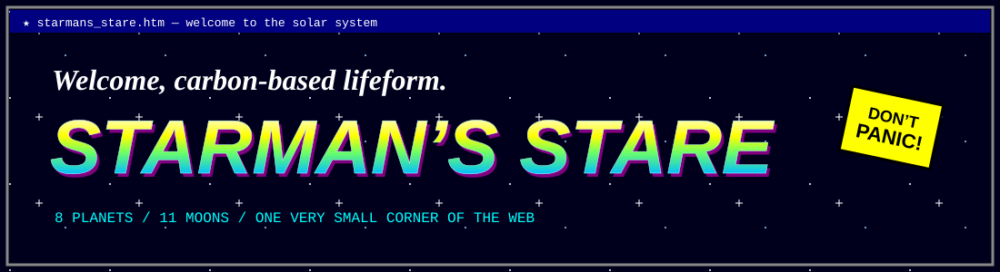
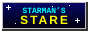

<p align="center"><a href="https://shalombaby666.github.io/starmans-stare/"></a></p>

<p align="center"><a href="https://shalombaby666.github.io/starmans-stare/"><b>Войти в обсерваторию →</b></a></p>

# Добро пожаловать, углеродная форма жизни

**Starman’s Stare** — маленький космический сайт, который застрял где-то между домашней страничкой 1998 года и бортовым компьютером из научной фантастики.

Здесь планеты служат кнопками, видео выдают на кассетах, а смотритель собирает хорошие ссылки и никак не может связаться с Major Tom. Звёздные обои прилагаются. Полотенце принесите своё.

## Куда нажимать

| Если хочется… | Вам сюда |
| --- | --- |
| Познакомиться с восемью планетами | [Планетный атлас](https://shalombaby666.github.io/starmans-stare/#atlas) |
| Узнать про океаны подо льдом и метановые озёра | [11 спутников](https://shalombaby666.github.io/starmans-stare/#moons) |
| Поставить Юпитер рядом с Землёй | [Сравнение](https://shalombaby666.github.io/starmans-stare/#compare) |
| Найти что-нибудь посмотреть или почитать | [Видеотека](https://shalombaby666.github.io/starmans-stare/#library) и [ссылки](https://shalombaby666.github.io/starmans-stare/#links) |
| Получить открытку с другого конца системы | [Архив полётов](https://shalombaby666.github.io/starmans-stare/#missions) |
| Доказать HAL, что вы тоже кое-что знаете | [Игровая](https://shalombaby666.github.io/starmans-stare/#arcade) |
| Собирать штампы посещённых миров | [Бортовой журнал](https://shalombaby666.github.io/starmans-stare/#journal) |

На главной ещё есть радиорубка с вымышленными передачами и бюро находок. Там лежат полотенце, дискета с Плутоном и кнопка клуба 88×31 — для вашей собственной странички.

[](https://shalombaby666.github.io/starmans-stare/)

## Как это выглядит

[](https://shalombaby666.github.io/starmans-stare/)

[Посмотреть мобильную версию](docs/screenshots/mobile.png)

## Космос настоящий. Эфир — выдуманный

У планет и спутников есть ссылки на досье [NASA Science](https://science.nasa.gov/solar-system/). Числа для сравнения взяты из [NASA Planetary Fact Sheet](https://nssdc.gsfc.nasa.gov/planetary/factsheet/) и округлены. В подборке материалов — NASA, ESA, NASA Eyes и Space Place; пока преимущественно на английском.

Карта — иллюстрация: положение и размеры объектов на ней условные. Пропорции диаметров соблюдаются в разделе сравнения. Каталог спутников содержит выбранные объекты, а не все известные луны. Период вращения планеты и солнечные сутки — разные величины; пояснения есть рядом с данными.

Журнал и закладки сохраняются только в вашем браузере. Регистрация не нужна. Анимацию можно выключить кнопкой наверху; системная настройка уменьшения движения тоже учитывается. Звука и автозапуска видео нет.

## Запустить у себя

Нужны **Node.js 22.18+** и **npm**.

```sh
git clone https://github.com/shalombaby666/starmans-stare.git
cd starmans-stare
npm ci
npm run dev
```

Откройте адрес, который выведет Vite. Другие команды:

```sh
npm test          # проверки каталога, сравнений и сохранённых отметок
npm run build    # production-сборка в dist/
npm run preview  # посмотреть сборку локально
```

<details>
<summary><b>Для тех, кто хочет заглянуть под панель</b></summary>

React 19 · TypeScript · Vite · SVG-пиксель-арт · статический хостинг.

- `src/data.ts` — каталог планет, спутников и материалов.
- `src/App.tsx` — навигация, атлас, сравнение, видеотека и журнал.
- `src/ClubRooms.tsx` — викторина, миссии и закладки.
- `src/HomeExtras.tsx` — радиорубка и бюро находок.
- `src/domain.ts` — расчёты и проверка сохранённых отметок.
- `src/PlanetSprite.tsx` — пиксельные рисунки планет и спутников.
- `src/styles.css`, `src/retro.css`, `src/pixel.css`, `src/house-style.css` — макет, ретро-детали, пиксельные края и единая палитра сайта.
- `DESIGN.md` — короткие правила общего визуального языка.

Системные шрифты подобраны под пиксельную аркаду и старые домашние страницы: Times New Roman для текста, Tahoma для управления, Courier New для служебных меток и Impact для логотипа. Внешние шрифты и аналитика не загружаются.

Приложение не требует сервера, базы данных или ключей API. Hash-навигация работает на статическом хостинге; относительные пути позволяют разместить сборку в подпапке. Для локального просмотра нужен HTTP-сервер — открывайте сайт через Vite, а не через `file://`.

Workflow в `.github/workflows/pages.yml` запускает тесты, собирает приложение и публикует `dist/` в GitHub Pages после push в `main`. При размещении своего форка выберите **GitHub Actions** как источник Pages.

</details>

## Нашли ошибку или принесли хорошую ссылку?

[Откройте issue](https://github.com/shalombaby666/starmans-stare/issues). Для поправки научного факта приложите источник; для ошибки интерфейса — страницу, браузер и скриншот. Новые материалы и небольшие pull request тоже приветствуются.

## Авторство и лицензия

Код и собственная графика распространяются под [MIT](LICENSE). Планеты нарисованы как оригинальные SVG-спрайты с пиксельной сеткой; кнопка и баннер — SVG. Внешние статьи и видео принадлежат их авторам.

Отсылки к «Автостопом по галактике», HAL 9000 и Major Tom — привет любимой фантастике. Проект не связан с NASA, ESA или правообладателями этих произведений.

---

<p align="center"><code>BEST VIEWED WITH YOUR EYES · MADE ON EARTH · PLEASE DO NOT FEED THE BLACK HOLE</code></p>
